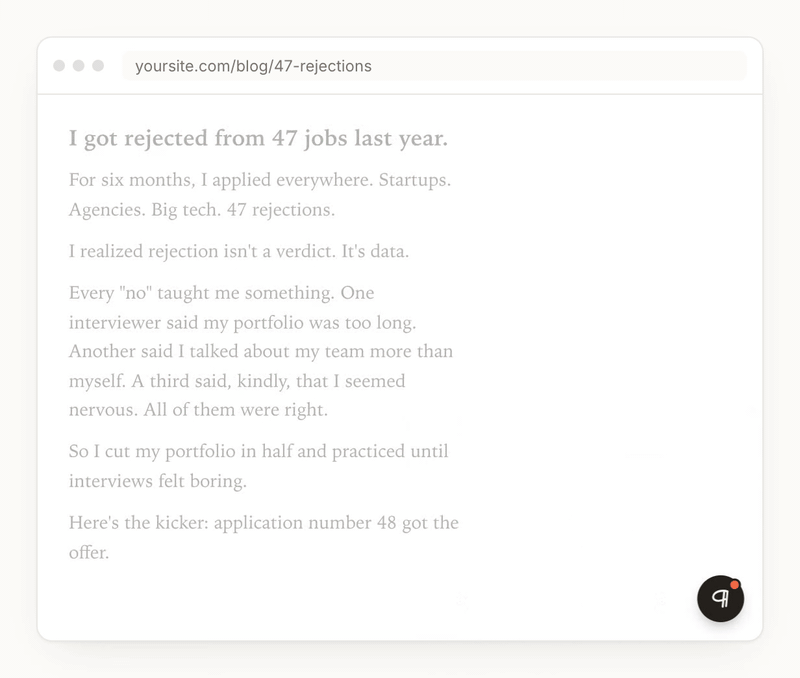
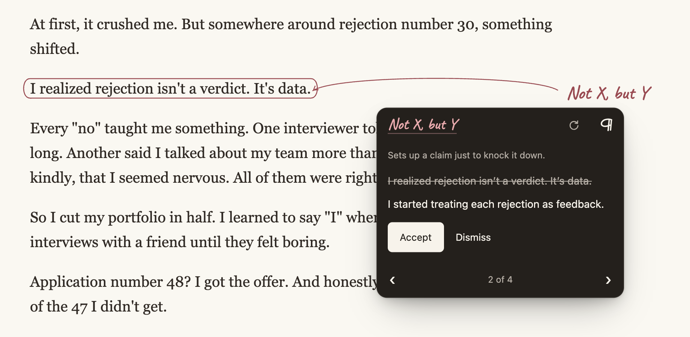

<h1>
  <picture>
    <source media="(prefers-color-scheme: dark)" srcset=".github/assets/proofmarks-dark.svg">
    
  </picture>
</h1>

Proofmarks marks AI-sounding writing on your real page, the way an editor marks up a proof. Ask your coding agent for a rewrite, then accept it straight into the source file.



## Quick start

Tell your coding agent, in your site's project:

> Set up Proofmarks on this site.

With the Proofmarks skill installed (`npx skills add tortastudios/proofmarks`), the agent installs it, configures it, starts it, checks it with `proofmarks doctor`, and opens the page for you. Then say "proof this page", and it rewrites every proof while you watch.

Or by hand, with Node.js 22 or later:

```sh
npm install --save-dev @tortastudios/proofmarks
npx proofmarks init
npx proofmarks dev --to http://localhost:3000
```

Open the address `dev` prints, with `?proof=1` on the end. There's no key to set up. To look around first, open the [gallery](examples/gallery/): nine kinds of writing, from a LinkedIn post to a long essay, each with a saved review.

No Node? Install Proofmarks with `brew install tortastudios/tap/proofmarks`, a one-line installer or `uv tool install proofmarks`, then run the same commands without `npx`. See [Install](docs/install.md).

## How it works

1. **Mark.** Proofmarks reads the page's source, whether Markdown, MDX, HTML or a template, and checks each passage against 20 rules, from "Not X, but Y" to "Generic voice". The marks land in the margin of the page you already have open.
2. **Rewrite.** Hover a mark to see why it reads as machine-made. Ask for a rewrite, and your agent gets the passage, its paragraph and the rule, then proposes a rewrite on the card.
3. **Decide.** Accept writes the rewrite into the source file. Dismiss keeps the mark from coming back. Undo restores the original. As you decide, each rule's line moves toward what your site keeps and dismisses.



Your writing leaves your machine only to be judged, or rewritten by the agent you choose. The passages go to Jev through Torta's relay, which doesn't keep them. Usage counts are off unless you turn them on (`proofmarks telemetry on`), and either way Proofmarks tunes its rules to your site on your machine. [TELEMETRY.md](TELEMETRY.md) lists everything Proofmarks sends, and to whom.

## Agents

Proofmarks works with the agent you already use. `init` connects the ones it finds, and each proof card lets you choose who rewrites.

| Agent | How it takes rewrites |
| --- | --- |
| Any agent, self-driving | Ask it to "proof this page" (in Claude Code, `/mcp__proofmarks__proof`). It rewrites every proof, checking each draft with the judge, while you watch the page. You accept. |
| Claude Code, Codex or pi, with no conversation | Proofmarks runs it for each rewrite, with its tools turned off. There's nothing to start. |
| An agent you're working with | Ask it to "watch Proofmarks" (in Claude Code, `/mcp__proofmarks__watch`). This works in any MCP client, including the desktop apps, Cursor, VS Code, `claude -p` and the Agent SDK. |
| pi | Requests arrive in the session on their own, through the Proofmarks extension. |
| Claude Code, pushed | Requests arrive on their own when you start it with `claude --dangerously-load-development-channels server:proofmarks`, a research preview. |

## Docs

- [Install](docs/install.md): npm, Homebrew, the installers, uv and pipx, and what `init` does.
- [Configuration](docs/configuration.md): documents, write access, rebuilds and private access.
- [Agents and MCP tools](docs/agents.md): self-driving, watch mode, the twelve tools, feedback, pi, push and setting up by hand.
- [Integrations](docs/integrations.md): the proxy, the script tag, React, Next.js and the examples.
- [Formats](docs/formats.md): Markdown, MDX, HTML and templates.
- [Checking without the page](docs/check.md): `proofmarks check` for CI and bulk runs, on files, folders and URLs.
- [Judge, privacy and usage counts](docs/judge.md): Jev, what is sent and kept, opting out, and using your own key.
- [FAQ](docs/faq.md), [security](SECURITY.md) and [contributing](CONTRIBUTING.md).

## License

[FSL-1.1-MIT](LICENSE.md): use Proofmarks for anything except offering a competing product or service, including your own sites and your clients' sites. Each version becomes MIT two years after its release. The [examples](examples/LICENSE) and script-tag snippets are MIT, and the Caveat handwriting font keeps its [OFL](src/overlay/OFL.txt).
